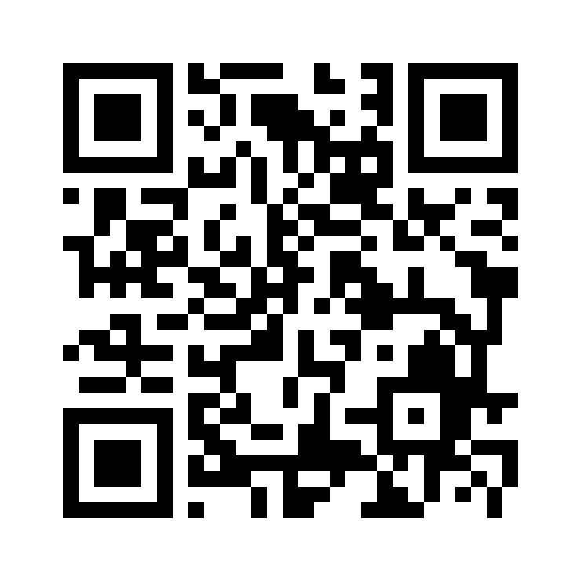

# Remoject

**Remoject 장비 제어용 Android 앱**  
Android controller app for Remoject.

## [⬇ APK 다운로드 / Download APK](https://github.com/actpot2863-svg/Remoject/releases/download/v3.0.0/Remote_injector_controller_R3.apk)

**버전 3.0 · Android용 · 약 3.6 MB**  
[배포 정보 보기 / Release details](https://github.com/actpot2863-svg/Remoject/releases/tag/v3.0.0)

## 설치 방법

1. Android 휴대전화에서 위 **APK 다운로드** 링크를 누릅니다.
2. 내려받은 `Remote_injector_controller_R3.apk`를 열고 설치합니다. 설치 권한 안내가 나오면 해당 다운로드 출처의 앱 설치를 허용합니다.
3. 앱 목록에서 **Remote injector controller**를 찾아 실행합니다.

## 다운로드 QR코드

제품 설명서나 포장에 사용할 수 있습니다. QR코드는 이 다운로드 안내 페이지로 연결됩니다.



[QR코드 PNG 다운로드](Remoject_download_QR.png) · [인쇄용 SVG 다운로드](Remoject_download_QR.svg)

## 기존 앱을 사용 중인 경우

이 APK는 새 서명키를 사용합니다. 기존 키로 설치된 동일 앱에는 업데이트 설치가 되지 않습니다. 기존 앱을 삭제하면 앱 데이터가 지워질 수 있으므로 필요한 설정과 데이터를 먼저 보관하세요.

## 배포 파일 정보

원본 AAB에서 설치용 APK로 변환했으며 앱 실행 코드와 이미지 파일을 유지했습니다. 파일 무결성과 APK 서명 검증을 완료했습니다. 실제 휴대전화 실행 및 Remoject 장비 연결 동작은 아직 확인하지 않았습니다.

| 항목 | 내용 |
| --- | --- |
| 앱 이름 | Remote injector controller |
| 앱 버전 | 3.0 |
| 설치파일 | Remote_injector_controller_R3.apk |
| 파일 크기 | 3,588,200 bytes |

SHA-256

```text
8ffa28ee069e05d4e6e4300b7fe8df606bcc8e4a778e78bffbed2080c199a9e9
```

## English

Download the APK above on your Android device, open the file, and follow the installation prompts. If prompted, allow app installation from the download source. The installed app is named **Remote injector controller**.

This APK uses a new signing key and cannot update an installation signed with the original key. Uninstalling an existing app may delete its data. APK integrity and signatures have been checked. Operation on a physical phone and connection to the Remoject device have not yet been tested.
